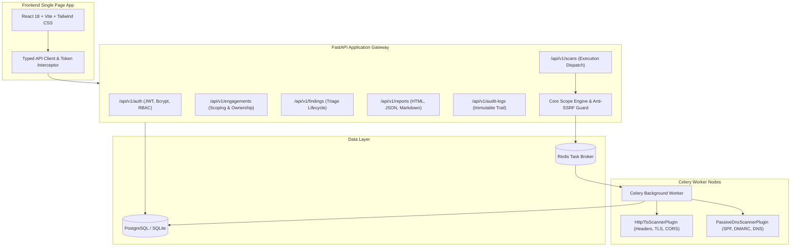

# AI-Assisted Penetration Testing Orchestration Platform

An enterprise-grade, multi-tenant AI-assisted orchestration platform for authorized penetration testing. Built with a FastAPI backend, Celery task worker queue, Redis, PostgreSQL/SQLite, and a modern React Vite TypeScript frontend.

---

## Architecture Overview



---

## Technical Stack

- **Backend**: Python 3.12, FastAPI, Pydantic v2 (ConfigDict), SQLAlchemy 2.0, Alembic
- **Database**: PostgreSQL 15 (Production) / SQLite in-memory (Automated Testing & Local Fallback)
- **Background Queue**: Redis 7 + Celery Distributed Task Worker
- **Frontend**: React 18, Vite 5, Tailwind CSS, TypeScript 5, Lucide Icons, React Router 6
- **CI/CD**: GitHub Actions workflow verifying backend unit/integration tests and frontend build

---

## Core Security Boundaries & Guardrails

1. **Anti-SSRF & Scope Enforcement Engine**:
   - Resolves target hostnames before execution to neutralize DNS-rebinding attacks.
   - Enforces strict cloud metadata protection: calls to `169.254.169.254`, IPv4 link-local `169.254.0.0/16`, and IPv6 link-local `fe80::/10` are blocked at the kernel scope boundary.
   - Evaluates target IP and domain against explicit engagement whitelist and exclusion rules.

2. **Domain Ownership Verification**:
   - Enforces explicit pre-scan domain verification via DNS TXT records (`_security-verification.<domain>`), HTTP well-known path tokens (`/.well-known/security-verification.txt`), or authorized manual administrator overrides.

3. **Multi-Tenant Row-Level Isolation**:
   - All models inherit from a common UUID base with organization tenancy keys.
   - Data access dependencies filter queries at the database layer using authenticated JWT claims.

4. **Append-Only Compliance Audit Trail**:
   - Every security-relevant event (`USER_LOGIN`, `USER_REGISTER`, `ENGAGEMENT_CREATE`, `ENGAGEMENT_UPDATE`, `ENGAGEMENT_DELETE`, `SCOPE_ADD`, `SCOPE_UPDATE`, `SCOPE_DELETE`, `SCAN_START`, `FINDING_TRIAGE`, `ENGAGEMENT_VERIFY`) is recorded in an immutable audit ledger with client IP origin and user agent.

5. **XSS-Safe Multi-Format Reporting**:
   - Penetration testing reports are generated in HTML (with contextual HTML entity escaping to prevent Stored XSS), machine-readable JSON, and Markdown formats.

6. **Role-Based Access Control (RBAC)**:
   - Granular permissions: `admin`, `tester`, and `viewer` roles controlling mutating endpoints versus read-only visibility.

---

## API Reference Summary

| Method | Endpoint | Description | Access Role |
| :--- | :--- | :--- | :--- |
| `POST` | `/api/v1/auth/register` | Register new organization & admin user | Public |
| `POST` | `/api/v1/auth/login` | OAuth2 compatible login, retrieve JWT | Public |
| `GET` | `/api/v1/auth/me` | Fetch active user profile and organization | Authenticated |
| `GET` | `/api/v1/engagements` | List all tenant engagements | Authenticated |
| `POST` | `/api/v1/engagements` | Create a new authorized testing engagement | Admin, Tester |
| `GET` | `/api/v1/engagements/{id}` | Retrieve engagement details | Authenticated |
| `PATCH`| `/api/v1/engagements/{id}` | Update engagement details or status | Admin, Tester |
| `DELETE`| `/api/v1/engagements/{id}` | Delete engagement and all child scans/findings | Admin |
| `POST` | `/api/v1/engagements/{id}/scope` | Add allowed or excluded scoping pattern | Admin, Tester |
| `GET` | `/api/v1/engagements/{id}/scope` | List configured scoping rules | Authenticated |
| `PUT` | `/api/v1/engagements/{id}/scope/{s_id}` | Update an existing scoping rule | Admin, Tester |
| `DELETE`| `/api/v1/engagements/{id}/scope/{s_id}` | Remove a scoping rule | Admin, Tester |
| `POST` | `/api/v1/engagements/{id}/verify` | Validate domain ownership (DNS/HTTP/Manual) | Admin, Tester |
| `GET` | `/api/v1/engagements/{id}/token` | Fetch verification token and DNS record name | Authenticated |
| `POST` | `/api/v1/scans` | Queue a safe or passive scan pipeline | Admin, Tester |
| `GET` | `/api/v1/scans` | List background scan jobs | Authenticated |
| `GET` | `/api/v1/scans/{id}` | Get status and details of scan job | Authenticated |
| `GET` | `/api/v1/findings` | Filter findings by engagement, severity, status | Authenticated |
| `GET` | `/api/v1/findings/{id}` | Inspect finding details and raw HTTP evidence | Authenticated |
| `PATCH`| `/api/v1/findings/{id}` | Update triage status, severity, or remediation | Admin, Tester |
| `POST` | `/api/v1/reports` | Export assessment report (html, json, markdown) | Authenticated |
| `GET` | `/api/v1/audit-logs` | Query tenant audit logs with pagination | Authenticated |
| `GET` | `/health` | Service health status check | Public |

---

## Local Development Setup

### 1. Backend Setup

```bash
cd backend
python -m venv venv
.\venv\Scripts\activate      # Windows
source venv/bin/activate      # macOS/Linux
pip install -r requirements.txt
```

### 2. Run Database Migrations

```bash
# SQLite local execution
$env:DATABASE_URL="sqlite:///./test.db"  # Windows PowerShell
export DATABASE_URL="sqlite:///./test.db"  # Linux / macOS
alembic upgrade head
```

### 3. Run Automated Tests

```bash
$env:PYTHONPATH="."  # Windows
export PYTHONPATH="." # Linux / macOS
pytest -v
```

### 4. Frontend Setup

```bash
cd frontend
npm install
npm run build
npm run dev
```

### 5. Running Full Stack via Docker Compose

```bash
docker compose up --build
```
Interactive API Swagger documentation is available at `http://localhost:8000/docs`.  
Frontend Web UI is accessible at `http://localhost:3000`.
